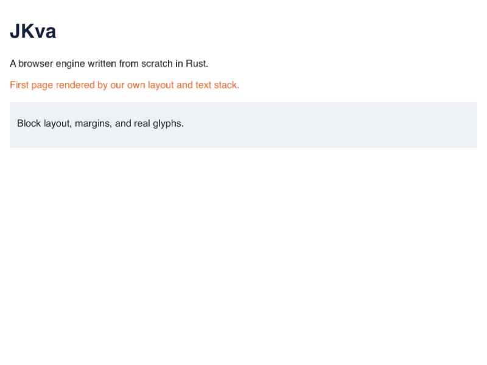

[English](README.md) | **Čeština**

[](https://github.com/meliodascz89/jkva/actions/workflows/ci.yml)

# JKva

> Browser engine psaný od nuly v Rustu. Apple Silicon first, megabajty last.

JKva je raná fáze browser engine: vlastní DOM, stylovací systém, layout, rasterizér, kompozitor i event loop — žádná zděděná dvacet let stará C++ vrstva, žádný fork Chromia.

**Stav: M2 — flexbox (podmnožina), herní platforma zahájena.** HTML se parsuje přes html5ever, CSS se parsuje a kaskáduje, blokový, inline a flex layout běží v `jkva-layout`, text se shapeuje a rasterizuje a Metal frame prezentuje. `examples/hello.html`, `cards.html` a `flex.html` se vykreslují v korpusu se zlatými obrázky. Flex umí row/column, `justify-content`, `align-items`, `align-self`, `gap`, `flex-wrap`, `flex-grow`, `flex-shrink` a `flex-basis`. Hraní je první třída 0.1 ([ADR-026](briefing/DECISIONS.md)): permission-gated UDP transport je v `jkva-net` (default deny, grant pro aplikaci i origin), GPU performance probe je další.



*První stránka vykreslená JKvou od začátku do konce: náš DOM, naše kaskáda, náš blokový layout, náš text a Metal. `examples/hello.html`, 800×600.*

## Kde právě jsme (2026-10-25)

- **M0 hotové** — repozitář, CI, dokumentace EN+CS, 24 ADR, Metal walking skeleton, IPC kontrakty (`jkva-ipc`) a harness: reftest diff, corpus runner, WPT report, WPT reftesty, benchmarky.
- **M1 hotové** — HTML → DOM → CSS kaskáda → blokový, inline a flex layout → shapeovaný text → Metal → PNG; tři zlaté stránky; seam pro damage; WPT reftest runner s publikovanými limity.
- **M2 rozpracované** — flexbox: `row`/`column`, `justify-content`, `align-items`, `align-self`, `gap`, `wrap`, `grow`/`shrink`/`basis`. Další: `order`, `align-content`, grid. Hraní: ADR-026, UDP s grantem, frame pacing, GPU capability report a první frame-time baseline (CPU submit p95 0,15 ms, GPU execution p95 1,22 ms na scéně s 4096 draw cally) hotové.
- 57 testovacích sad zelených, CI zelené, kaskáda ~1,94 ms na fixture se 602 uzly.

Kontrolovatelný seznam s důkazy a známými mezerami je [`docs/src/cs/status.md`](docs/src/cs/status.md) ([anglicky](docs/src/en/status.md)).

## Co v repozitáři je

| Cesta | Co to je |
|---|---|
| `crates/` | engine, jeden crate na vrstvu (`jkva-core`, `jkva-dom`, `jkva-style`, `jkva-layout`, `jkva-text`, `jkva-paint`, `jkva-gfx`, `jkva-js`, `jkva-api`, `jkva-engine`, `jkva-platform`, `jkva-shell`) |
| `briefing/` | 99 rozhodnutí, na kterých stojí architektura, odpovědi a z nich odvozené ADR |
| `research/` | ověřené podklady o crate ekosystému 2026, benchmarcích a prior artu |
| `docs/` | dokumentace v angličtině a češtině (mdBook) |
| `decisions/` | odkaz na záznam rozhodnutí |

## Sestavení

```bash
# vyžaduje Rust stable (edition 2024) a macOS na Apple Silicon
cargo build --workspace
cargo run -p jkva-platform --bin metal-probe   # vypíše Metal zařízení
cargo test --workspace
```

Toolchain, cíle a CI jsou popsané v [`docs/src/cs/building.md`](docs/src/cs/building.md).

## Kde jsou rozhodnutí

- [`briefing/DECISIONS.md`](briefing/DECISIONS.md) — 24 ADR: rozsah, architektura, měření, tým.
- [`briefing/BRIEFING-0.1.cs.md`](briefing/BRIEFING-0.1.cs.md) — 99 otázek a zvolené odpovědi.
- [`briefing/ANSWERS.md`](briefing/ANSWERS.md) — odpovědi včetně odchylek od doporučení.

## Podpora projektu

JKva nemá paywall, tokeny, placené funkce ani roadmapu na prodej. Pokud i tak chceš vývoj podpořit, jediná adresa je:

**Bitcoin (BIP84, native segwit):** `bc1qg9y4mwhc4c5ekexc4nfr6vxynfq0m8nq9vqqj2`

Dar není nákup: nekupuje funkce, prioritu ani vliv na architekturu. Projekt zůstává veřejný pod dvojí licencí a každé rozhodnutí zůstává v [`briefing/DECISIONS.md`](briefing/DECISIONS.md).

## Licence

MIT. Viz [`LICENSE-MIT`](LICENSE-MIT).
